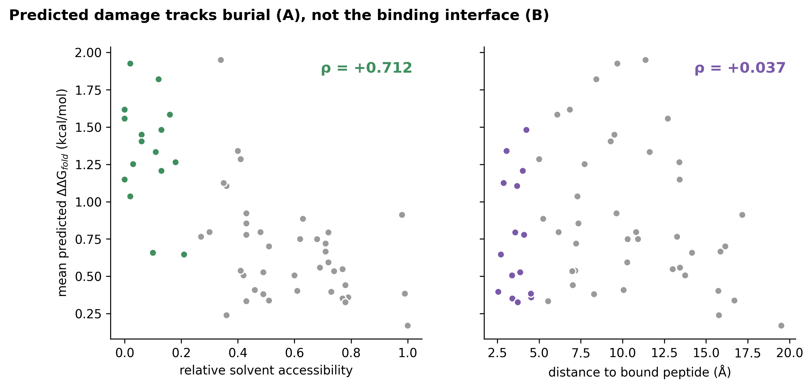
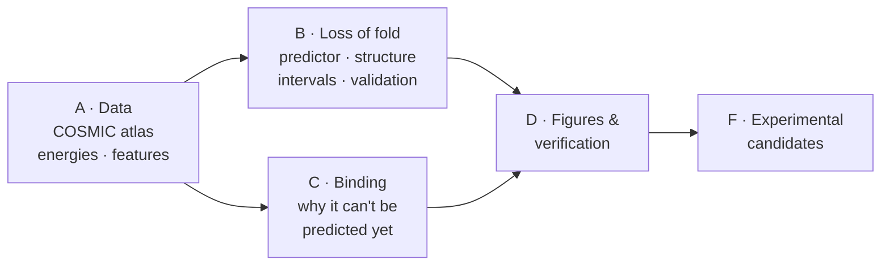

# SH3 mechanism atlas

**Does a cancer mutation in a human SH3 domain break the fold — or leave it intact and change binding?**

Mechanism-resolved prediction of cancer mutation effects · distinguishing loss of fold from the limits on predicting rewiring of binding

 

 

[Results](#-headline-results) · [Pipeline](#-the-pipeline) · [Phase 2](#-phase-2--external-validation) · [Run it](#-how-to-run) · [Report](../docs/REPORT.md) · [Full technical README](../README.md)

---

## 📊 Headline results

  

 

<table>
<tr>
<td align="center" width="25%"><h3>ρ 0.839</h3>per-domain median on 15 held-out SH3 domains</td>
<td align="center" width="25%"><h3>15 / 15</h3>domains where the head beats zero-shot ESM-2</td>
<td align="center" width="25%"><h3>410</h3>cancer variants confidently destabilising (6%)</td>
<td align="center" width="25%"><h3>~80 vs 56–60</h3>positions needed vs available to predict binding</td>
</tr>
</table>

| Finding | In short |
|---|---|
| ✅ **Folding is predictable** | Per-domain median Spearman ρ 0.839, SH3 family held out as a whole |
| ✅ **…and specific to folding** | Predicted damage follows burial (ρ +0.712), not the binding interface (ρ +0.037). Structure was never a model input |
| ⛔ **Binding is not predictable from current data** | Needs ~80 distinct mutated positions; an SH3 domain has 56–60. The fix is more domains, not more mutations |
| ⚪ **Cancer biology is null** | 1 of 170 genes and 0 of 22 tumour sites enriched against a burial-matched null — a mechanism map, not a driver list |
| 🔁 **Stage 0 is exact** | The original atlas rebuilds byte-for-byte from raw COSMIC |
| ⚪ **Specificity axis (C4)** | 154 PWMs; did not pass its preregistered rule, so no rewiring claim is made |

> [!WARNING]
> **Withdrawn 28 September 2026:** an earlier claim that cancer variants are depleted of fold-breaking substitutions. A trinucleotide-aware null (G1) showed it was mutational bias (5.96% observed vs 6.04% expected, p = 0.40). Details in [`extended/results/G1_mutational_context/`](../extended/results/G1_mutational_context/).

---

## 🧬 The pipeline

| Part | Notebooks |
|---|---|
| **A** Initial data processing | A0 cancer atlas from raw COSMIC · A1 measured folding/binding energies · A2 features |
| **B** Loss of fold | B1 folding predictor · B2 structural check · B3 intervals and calls · B4 external validation · B5 cancer biology · B6 virtual saturation mutagenesis |
| **C** Binding limits | C1 across domains · C2 within a domain · C3 positions, not rows · C4 independent specificity axis |
| **D** Verification | D1 figures and verification |
| **F** Follow-up | F1 experimental validation candidates · F2 candidate figures |

Start with [`docs/00_pipeline_overview.md`](../docs/00_pipeline_overview.md), or read the paper-style write-up in [`docs/REPORT.md`](../docs/REPORT.md).

<b>Reproducibility record</b>

 

All 14 programs ran from raw data and **all 187 recorded values reproduced** (160 identical, 27 within tolerance). Four problems were found and fixed along the way, and three procedural flaws found on re-checking are kept visible beside their corrections. See [`ANALYSIS_D1.md`](../results/D1_figures_and_verification/ANALYSIS_D1.md) and [`CRITICAL_ANALYSIS.md`](../results/CRITICAL_ANALYSIS.md).

---

## 🔭 Phase 2 — external validation

The run above is frozen. [`extended/`](../extended) reads it without modifying it, aiming to close the remaining objections before journal submission.

| Program | Question |
|---|---|
| X0 | Acquire and verify the external data |
| E1 | Do the 410 destabilising calls agree with ClinVar and gnomAD? |
| E2 | Do they agree with measured human protein abundance? |
| E3 | How does the folding head compare with SaProtΔG, ESM3ΔG and ThermoMPNN? |
| E4 | Does the C4 specificity model fail a second, independent test? |
| G1–G4 | Signature-aware null, per-domain conformal, AlphaFold fragments, panel redesign |
| H1–H2 | A second domain family; bench validation |

**First result:** 880 of 6,884 atlas cancer variants have a direct measurement in Human Domainome 1.0. The frozen head, trained with the whole SH3 family held out, reaches pooled Spearman ρ = −0.600 against measured abundance.

---

## ▶️ How to run

1. Obtain the inputs (≈ 8 GB) — see [`docs/DATA_ACCESS.md`](../docs/DATA_ACCESS.md).
2. Run the notebooks in order on Colab (≈ 2.5 h; GPU for 7 of them).
3. Read the two reports in each results folder: `RESULTS_<ID>.md` (written by the run) and `ANALYSIS_<ID>.md` (the interpretation). See [`results/README.md`](../results/README.md).

> **Data are not in this repository.** COSMIC's licence forbids redistribution; raw archives, per-variant tables, embeddings and model weights are kept outside git.

---

**Md Hafijur Rahman** · MSc Biomedical Technology, Dokuz Eylül University

