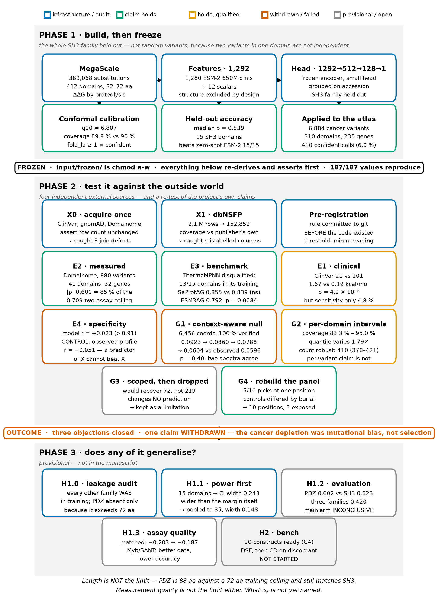

# Methodology

The complete method, in order, with the reasoning for each decision and what it produced.

Every section answers three questions: **what was done**, **why it was done that way rather than an
obvious alternative**, and **what came out**.



*Figure — the full pipeline. Phase 1 builds and calibrates the model; Phase 2 tests it against four
independent external sources and re-tests its own claims; Phase 3 asks whether any of it generalises
beyond one protein family. Colour marks the outcome of each program. Generated by
`tools/fig_methodology.py`.*

---

# 1. The question, and why it is framed this way

**Does a missense variant break the protein's fold, or leave it folded and change what it binds?**

SH3 domains are the test case: ~60 residues, one of the most common interaction modules in the human
proteome, 310 domains across 235 genes in the cancer atlas, and — critically — **a family with enough
measured stability data elsewhere to hold out entirely.**

The design decision that shapes everything downstream: **hold out the whole family, not random
variants.** Random splits leak, because two variants in the same domain share almost all of their
context. Holding out SH3 means every number reported on SH3 comes from a model that never saw the
family.

---

# 2. Phase 1 — building the model

## 2.1 Training data

| | |
|---|---|
| Source | MegaScale (Tsuboyama 2023), cDNA-display proteolysis |
| Size | 389,068 substitutions across **412 domains** |
| Used for training | ~361,000 non-SH3 substitutions |
| Target | ΔΔG of folding, kcal/mol, **sign negated on load** so positive = destabilising |

**Why this dataset.** It is the only source with folding free energies at this scale measured
consistently by one method. Mixed-source training would confound the model with assay differences.

**A property that mattered later and was not noticed at the time:** the assay caps constructs at
**72 residues**. Every training domain is 32–72 residues, median 51. Phase 3 found this and it is now
a stated limitation.

## 2.2 Features — 1,292 per variant

| component | count | |
|---|---|---|
| ESM-2 650M embedding of the mutated residue | 1,280 | last hidden state of the **wild-type** domain sequence, position `pos − 1` |
| ESM log-odds features | 3 | `esm_score` (mut − wt), `esm_wt_logp`, `esm_entropy` |
| Position | 2 | `rel_pos`, `dom_len` |
| Chemistry | 7 | Δhydropathy, Δvolume, Δcharge, BLOSUM62, to-proline, from-glycine, to-glycine |

**Why structure is not a feature.** MegaScale has no structure on any of its 389,068 rows, while the
atlas has it on 96.8 %. A model using structure would **train on one distribution and predict on
another**. Keeping it out also makes the structural check (B2) an independent test rather than a
restatement of an input.

**Why the embedding is of the wild-type sequence.** One forward pass per domain rather than one per
variant — 412 passes instead of 389,068. The consequence is deliberate and stated: two substitutions
at the same position share 1,280 of their 1,292 features and differ only in the scalars.

**Why a frozen encoder with a small head.** ~361,000 measurements against a 650M-parameter encoder
would memorise. The head is 1,292 → 512 → 128 → 1.

## 2.3 Splits

Grouped on **UniProt accession and domain index**, with the entire SH3 family held out.

**Why grouped.** Two variants in one domain are not independent observations. A random split would
put some of a domain's variants in training and some in test, and the reported accuracy would be
optimistic by an amount nobody could estimate afterwards.

## 2.4 Calibration — turning a prediction into a decision

A point prediction cannot support *"this variant is confidently damaging"*. **Normalised
split-conformal prediction** converts the seed ensemble's disagreement into an interval with a
guaranteed coverage rate:

```
fold_lo = predicted ΔΔG − q90 × (ensemble SD + 0.05)
```

**Why conformal rather than the ensemble SD directly.** The SD is a heuristic; conformal gives a
distribution-free coverage guarantee. The normalisation by SD lets the interval widen where the
ensemble disagrees.

**Outcome.** q90 = **6.807**, empirical coverage **89.9 %** against a 90 % target.
**`fold_lo ≥ 1`** is the confident-destabilising call, and **410 of 6,884 atlas variants (6.0 %)**
meet it.

## 2.5 What Phase 1 produced

| | |
|---|---|
| Per-domain accuracy, 15 held-out SH3 domains | **median ρ 0.839** |
| Against zero-shot ESM-2 | better on **15 of 15** |
| Confident calls on the atlas | 410 of 6,884 |
| Reproduction | 187/187 recorded values |

**Then it was frozen.** `input/frozen/` is `chmod a-w`. Every subsequent program reads it and asserts
the numbers reproduce before doing anything else. **No result below re-fitted anything.**

---

# 3. Phase 2 — testing it against the outside world

## 3.1 The reasoning

Phase 1's evidence is internal: a held-out split of one dataset. Four objections stand against it, and
each needed a different external source:

| # | objection | what answers it |
|---|---|---|
| 1 | only beaten weak baselines | current supervised predictors (**E3**) |
| 2 | the depletion could be mutational bias | a context-aware null (**G1**) |
| 3 | generality asserted from *n* = 1 | more domains (**E2**) |
| 4 | nothing was measured | an independent assay (**E2**), clinical labels (**E1**) |

## 3.2 X0, X1 — acquire once, verify, and assert

**Why a separate acquisition step.** If every program downloads and filters its own copy, they
diverge silently. X0 fetches ClinVar, gnomAD and Domainome; X1 reduces dbNSFP.

**The method that matters:** `assert len(out) == n` after every merge onto the atlas.

**Outcome.** The assertion caught **three join defects** that would each have produced a larger,
plausible atlas: 45 null-key rows, **3,856 rows duplicated by dual Pfam annotation** of the same
domain, and 249 contradictory ClinVar keys. A caching bug that recorded HTTP failures as "no
variants" would have silently lost ARHGEF4's 8,140 variants.

X1's lesson is different and sharper: **a derived table needs at least one number checkable against
something outside itself.** Comparing predictor coverage to dbNSFP's own published figures caught a
defect in which every predictor column was correctly populated but **mislabelled** — a complete,
internally consistent, entirely wrong file that no internal check could have found.

## 3.3 E2 — the measured comparison, and the ceiling that makes it readable

880 atlas variants have a direct abundance measurement in Human Domainome 1.0, across 41 domains and
32 genes.

**Why a noise ceiling is computed first.** A correlation of 0.600 is meaningless without knowing what
is achievable. **Two independent assays agree with each other at |ρ| = 0.709.** No predictor can beat
that.

**Outcome.** Pooled |ρ| **0.600 — 85 % of the ceiling**, and 90–113 % on matched variants. 21 of 21
sufficiently sampled domains correlate in the right direction.

## 3.4 E3 — the benchmark, and the audit that came first

**Why the audit precedes the comparison.** A predictor trained on the same data we held out would
score its own training set against our test set. So the training splits of every candidate were
checked **before** any of them ran.

**Outcome.** **ThermoMPNN was disqualified: 13 of our 15 held-out domains sit inside its published
train or validation split** — 23,191 of 27,590 variants. Two competitors remained, both
structure-conditioned and both *given the experimental structure of the measured construct*, against
our sequence-only model:

| | median ρ | ours | p |
|---|---|---|---|
| SaProtΔG | 0.855 | 0.839 | 0.107 — no clear difference |
| ESM3ΔG | 0.792 | 0.839 | **0.0084 — ours better** |

27,590 variants scored by each, **0 dropped**. Consistency is the real finding: ESM3ΔG ranges
0.460–0.892 across domains, ours 0.754–0.934.

## 3.5 E1 — clinical labels

**Why both a continuous and a rate comparison.** Collapsing 21 pathogenic variants to a proportion
discards most of the information, so the distribution comparison is primary.

**Outcome.** Median predicted ΔΔG **1.67 vs 0.19** kcal/mol, p = 4.9 × 10⁻⁶, rank-biserial **+0.615**
(AUC ≈ 0.81) — from a model that never saw a clinical label.

**And a negative that matters more:** `fold_lo ≥ 1` flags only **4.8 %** of pathogenic variants. That
is not a disagreement about biology; it is what a 90 % *lower bound* means. **It is a shortlisting
tool, not a clinical filter**, and must be reported with its sensitivity.

## 3.6 E4 — the control that decides the reading

C4's specificity axis had already failed its own rule internally. E4 tested it against 44
independently measured affinities.

**Why a control on the observed data.** The pre-registration fixed the reading in advance: if the
*observed* phage-display profile — the quantity the model is trained to predict — also fails, then the
failure is in the representation, not the fit.

**Outcome.** Model r = **+0.023** (p = 0.91). Observed profile r = **−0.051** (p = 0.80). **A
predictor of X cannot beat X**, so no improvement to the regression could have produced a positive
result. Verdict: *the measurement, not the model.* Collapsing a 14-position matrix to composition
discards order, and SH3 ligand classes differ by order at identical composition.

## 3.7 G1 — the test that overturned our own claim

Phase 1 reported cancer variants depleted of fold-breaking substitutions — 5.93 % against 9.18 %
expected — and stated that a trinucleotide-aware null was needed before calling it selection.

**Why the null had to change and not the model.** Mutation is not uniform: C>T at CpG is an order of
magnitude more likely than most changes. If the substitutions that are *common* are also the ones that
are *mild*, a uniform null reports depletion where there is no selection.

**Method.** Genomic coordinates recovered for 6,456 of 6,884 atlas variants — **all 6,456 verified
against the GRCh38 reference base**. Trinucleotide context read from the genome. 10,000
domain-matched draws weighted by a 96-channel spectrum, run twice under two independently specified
spectra.

**Outcome — the claim is withdrawn:**

| null | rate | change | p |
|---|---|---|---|
| Phase 1, amino-acid-pair reachability | 0.0923 | — | 0.001 |
| codon reachability | 0.0860 | −0.64 pp | 0.0001 |
| + reachability multiplicity | 0.0788 | −0.71 pp | 0.0001 |
| **+ trinucleotide context** | **0.0604** | **−1.84 pp** | **0.401** |

**The depletion survives both reachability corrections and dies on sequence context alone** — exactly
the test the original report said was missing. Both spectra agree despite describing the mutational
process very differently (cosine 0.688).

Two defects in the original null were found on the way: `snv_reachable` asked whether a substitution
is reachable from *some* codon rather than *the* codon present (r = +0.955 against the genetic-code
prediction across 150 amino-acid pairs), and drawing at the amino-acid level ignored that one change
can be reached by several base changes with different contexts.

## 3.8 G2, G3, G4 — three checks on the published numbers

**G2 — is the 90 % interval really 90 % everywhere?** Coverage runs **83.3 % (LYN) to 95.0 % (FYN)**,
and the per-domain quantile varies by **1.79×**. Resampling per-domain quantiles puts the confident
count at **400 with a band of 378–421**. So the **aggregate count is robust; the per-variant claim is
not.**

**G3 — scoped, then dropped.** The planned AlphaFold fix would have recovered 72 variants rather than
219, changed **no prediction** (structure is annotation only), and its motivating variant sits in a
domain no model covers. Recorded as a limitation instead of run.

**G4 — the experimental panel had to be rebuilt.** Selecting by confidence alone put **5 of 10 picks
at one position, all replacing alanine**, and left the destabilising picks 8/10 buried while the
controls sat at exposed termini — so the two sets differed in **burial** as much as in predicted
effect. Rebuilt under explicit constraints: one pick per aligned position, one proline, reserved
places for **exposed** predictions, and controls drawn from buried positions in the same domains.

---

# 4. Phase 3 — does any of it generalise?

## 4.1 The audit that had to come first

**Why.** The model held out SH3 and trained on everything else, so *every other family was in
training*. Applying it to a second family only tests generality if that family is genuinely absent.

**Outcome.** PDZ is absent — **but because it is too long.** MegaScale caps at 72 residues; PDZ runs
70–97. Evaluating on PDZ alone would confound *new family* with *longer than training*. Three
families are absent **and** length-matched: Myb/SANT, PHD, B-box.

## 4.2 The design, and the calculation that changed it

**Non-inferiority, not significance.** "Comparable accuracy" cannot be shown by failing to reject a
null. The margin is **−0.15**, one SD of SH3's own domain-to-domain spread.

**The power calculation is why the arm was redesigned.** At 15 domains the 95 % interval is 0.243
wide — wider than the margin, so the answer would have been *inconclusive whatever the data said*.
Pooling three length-matched families to 35 domains brings it to 0.148.

## 4.3 Outcome — provisional

| | |
|---|---|
| PDZ, never seen, **88 residues against a 72 training ceiling** | 0.602 vs SH3's 0.623 |
| Three length-matched families | 0.420 — **inconclusive** |
| Is it measurement quality? | **No** — matched, Δ moves only −0.203 → −0.187 |

**Myb/SANT is the informative case:** better measurements than SH3 and lower accuracy. Whatever
limits the main arm is neither length nor noise, and is not yet named.

---

# 5. The methods that run through everything

## 5.1 Pre-registration

The decision rule — the main comparison, the threshold, the minimum group size, and **how each
possible outcome would be read** — committed to git **before the analysis code existed**.

**Why.** A threshold chosen after seeing the result carries no information.

**What it cost, and earned:**

| | |
|---|---|
| **E3** | disqualified ThermoMPNN before running it |
| **E4** | the control stopped a wrong conclusion from a correct number |
| **G1** | overturned one of the project's own headline claims against a threshold fixed beforehand, with "the claim is withdrawn" written in advance |
| **H1** | the power calculation showed the original design would have returned *inconclusive* regardless |

## 5.2 Assert what a join keeps

**Why.** A wrong key produces a *smaller, plausible, internally consistent* table rather than an
error — the class of defect that survives to publication.

**Four position-index defects were caught this way**, and each had a minority that agreed by luck:

| defect | agreed by coincidence |
|---|---|
| B6's `pos` is domain-relative, not a protein position | 147 of 6,884 |
| dbNSFP's `aapos` on a different isoform (twice) | 23.7 % disagreed |
| Domainome's `position` is UniProt numbering | 1,774 of 119,394 |

## 5.3 One external check per derived table

**Why.** A reduction has no ground truth of its own. Every derived table is checked against something
it does not control: predictor coverage against the publisher's figures, coordinates against the
GRCh38 reference base, our re-derivation against the frozen run's published value.

## 5.4 The frozen run is read-only

`input/frozen/` is `chmod a-w`. Every extended program re-derives the published numbers and asserts
they match before proceeding. **Across all of Phase 2 and Phase 3, no frozen output was ever
recomputed.**

---

# 6. What the methodology produced, in one table

| claim | status | evidence |
|---|---|---|
| Per-domain folding accuracy 0.839 | **holds** | re-derived in E3; competitive with two current predictors |
| Beats zero-shot ESM-2 15/15 | **holds** | extended to supervised predictors |
| 410 confident calls | **holds, with two caveats** | 4.8 % sensitivity (E1); band 378–421 (G2) |
| External measured validation | **new** | 0.600, 85 % of the 0.709 ceiling (E2) |
| Clinical separation | **new** | p = 4.9 × 10⁻⁶, rank-biserial +0.615 (E1) |
| Cancer-variant depletion | **withdrawn** | mutational bias, not selection (G1) |
| Specificity axis | **failed, correctly attributed** | the representation, not the model (E4) |
| Generality beyond SH3 | **partial, provisional** | one family matched, three inconclusive (H1) |
