# Mechanism-resolved prediction of cancer mutation effects in human SH3 domains

### Loss of fold is predictable; the limits on predicting rewiring of binding are quantified

**Hafijur Rahman**
Master's thesis project, Dokuz Eylül University
Report of the full reproduction run of 22 September 2026

---

## Abstract

**Background.** Somatic missense mutations in modular interaction domains can act through at least two
distinct mechanisms: destabilisation of the fold, or retention of the fold with altered partner binding.
Distinguishing them is a prerequisite for interpreting variants of unknown significance, yet
recurrence-based methods are powerless in domain families that are rarely mutated recurrently.

**Methods.** We assembled a cancer-variant atlas for human SH3 domains from COSMIC v104 and a frozen UniProt
snapshot (6,884 residue-verified missense variants in 310 domains of 235 genes). Measured folding and binding
free energies were taken from ddPCA/MoCHI (three domains, one of them an SH3) and from a mega-scale
proteolysis dataset (389,068 single substitutions in 412 domains). A supervised head on frozen ESM-2 650M
embeddings plus 12 physico-chemical scalars (1,292 features) was trained on non-SH3 data with the entire SH3
family held out. Uncertainty was handled by normalised split-conformal prediction. Binding predictability was
probed by three nested designs (across domains, within a domain holding out positions, and by controlled
removal of measurements versus positions), and by an independent specificity model trained on 154
phage-display specificity profiles with a pre-registered validation rule. All 16 programs were re-executed
from raw data and checked against 187 recorded values of an earlier run.

**Results.** Folding is predictable for SH3 domains never seen in training: per-domain median Spearman
ρ = 0.839 (range 0.754–0.934) over 15 held-out domains, beating zero-shot ESM-2 on 15 of 15 (two-sided sign
test p = 6.1 × 10⁻⁵). The predictions are specific to folding: across the 56 aligned positions, predicted
damage tracks burial (ρ = +0.712) and not the peptide interface (ρ = +0.037), although structure was never a
model input. With 90 % conformal intervals (empirical coverage 89.9 %), 410 of 6,884 cancer variants (6.0 %)
are confidently destabilising. Binding, by contrast, is not predictable for SH3 from current data: within
GRB2-SH3 the median of six repeats is ρ ≈ 0, and the previously reported positive values arise from
test-domain leakage and from single-split reporting. Controlled removal shows the limiting resource is
**positional coverage, not the number of measurements**: thinning measurements while retaining all 84
positions of PSD95-PDZ3 leaves ρ ≈ 0.33, whereas removing positions at the same budget collapses it to
ρ ≈ 0.05; predictability appears at ~76 positions and is robust by 82, against 56–60 residues in an SH3
domain. An independent specificity axis over 115 SH3 domains did not pass its pre-registered rule
(median centred r = +0.288; better than the family-average profile on only 55 of 115 domains), so no rewiring
claim is made. Cancer biology is null: 1 of 170 genes and 0 of 22 tumour sites are enriched for destabilising
variants against a burial-matched permutation null. A virtual saturation scan of all 310 domains (366,168
substitutions) shows observed cancer variants are *depleted* of fold-breaking substitutions relative to a
domain-matched single-nucleotide background (5.9 % vs 9.2 %, p ≤ 0.001).

**Conclusions.** For human SH3 domains, loss of fold can be predicted and calibrated from sequence alone;
rewiring of binding cannot, and the reason is a quantifiable data limit that no amount of mutagenesis of a
single domain can overcome. The atlas is a mechanism map, not a driver list. All results reproduce exactly
from raw data (187/187 recorded values).

---

## 1. Introduction

SH3 domains are ~60-residue β-barrel modules that mediate protein–protein interactions, canonically by
binding proline-rich PxxP motifs, and they are among the most abundant interaction modules in the human
proteome [1]. Because they are small, autonomously folding and structurally well characterised, they are a
natural test system for the general question raised by cancer genomics: for a given missense variant, *what
does it do mechanistically*?

Two mechanisms dominate for an interaction domain:
1. **Loss of fold.** The substitution destabilises the domain, so the protein is degraded or fails to fold, and all interactions are lost.
2. **Rewiring of binding.** The fold is retained but affinity or specificity for partners changes.

Deep mutational scanning with a doubledeepPCA design has made both energies measurable at scale for a small
number of domains, and the associated thermodynamic model (MoCHI) separates ΔΔG of folding from ΔΔG of
binding for every variant [2]. Independently, a mega-scale proteolysis experiment has produced folding
stabilities for hundreds of thousands of variants across hundreds of small domains [3]. Protein language
models such as ESM-2 supply a zero-shot score for any substitution and features that transfer across families
[4,5,6].

This project asks whether these resources are sufficient to assign a mechanism to the SH3 cancer variants
catalogued in COSMIC [7], and — where they are not — to quantify precisely what is missing. A previous run of
the project produced a first answer. The work reported here rebuilds every step from raw data, re-checks 187
recorded quantities, corrects the procedural flaws found on re-inspection, and adds four experiments.

**Contributions.**
1. A reproducible pipeline from raw COSMIC to figures, in 16 programs, that rebuilds the cancer atlas byte-for-byte and re-checks every recorded value.
2. A folding predictor validated by leave-family-out design, with conformal intervals, structural specificity tests, and external validation that delimits where it stops working.
3. A quantified negative result for binding: the limiting resource is positional coverage (~80 positions), which single-domain mutagenesis cannot supply.
4. A pre-registered, and failed, attempt at an ESM-independent specificity axis; reported as a data limit rather than a claim.
5. A virtual saturation mutagenesis resource for all 310 atlas domains, and a candidate panel for experimental validation.

---

## 2. Literature review

This section surveys the five bodies of work the project stands on: what SH3 domains do and how their
specificity is encoded; how mutational effects became measurable at scale; how those measurements are turned
into statements about mechanism; what is known about predicting stability and binding changes
computationally; and what cancer genomics can and cannot say about a rarely mutated domain family. Each
subsection ends with the gap that motivates the present work.

### 2.1 SH3 domains: abundant modules with under-determined specificity

SH3 domains are ~60-residue β-barrels of five antiparallel strands that bind short proline-rich motifs across
a shallow surface of conserved aromatic residues [1]. They are among the most common interaction modules in
the human proteome and organise signalling, cytoskeletal regulation and endocytosis [1]. The canonical ligand
is a PxxP motif, read in either of two orientations, but the consensus-motif view has been eroded: a review
of binding modes concluded that canonical consensus sequences explain neither affinity nor selectivity for
many domains, because contacts outside the proline groove contribute substantially [32]. A comprehensive
phage-display survey of the human family then quantified the problem: from ~70,000 unique binding peptides,
154 specificity profiles for 115 domains showed that roughly half of human SH3 domains have **non-canonical**
specificity, several of them binding through surfaces distinct from the classical site [9].

The consequence for variant interpretation is direct. In a family whose specificity is heterogeneous and
partly encoded outside the canonical site, predicting how a substitution rewires binding cannot rely on motif
logic; it needs either measurements on the domain itself or a model trained across many domains. Both routes
are tested here (Sections 5.8–5.10).

### 2.2 Measuring mutational effects at scale

Deep mutational scanning couples a variant library to a selection and a sequencing readout, giving
quantitative scores for thousands of variants in one experiment [33]. Two developments matter for mechanism.

First, **double deep PCA (ddPCA)** measures abundance and binding for the same library and fits a
thermodynamic model (MoCHI) that separates the free energy of folding from the free energy of binding, with
error estimates, for every variant [2]. This is what turns "loss of fold versus rewiring" into an
experimentally defined distinction rather than an interpretation. The published dataset covers three domains
— GB1, GRB2-SH3 and PSD95-PDZ3 — and therefore contains exactly **one** SH3 domain with measured binding
energies.

Second, **cDNA display proteolysis** raised throughput for folding stability alone by orders of magnitude,
yielding high-quality stabilities for ~776,000 variants across hundreds of natural and designed domains of
40–72 residues [3]. This asymmetry — folding measured across hundreds of domains, binding across three —
propagates into any model trained on these data, and is the structural reason for the asymmetry of the
results reported here.

### 2.3 From energies to mechanism: destabilisation, degradation and edgetics

A body of work connects thermodynamic destabilisation to cellular phenotype: many disease variants act by
lowering the folded fraction, which triggers degradation and reduces abundance, rather than by abolishing a
catalytic or binding function directly [34]. The same review formalises the corollary used here: because
stability effects are largely determined by position and by the chemistry of the substitution, they
generalise across proteins far better than functional effects do.

The complementary mechanism is **edgetic**: a variant that leaves the protein folded but removes or alters a
subset of its interactions. Systematic interaction profiling of disease alleles found that a substantial
fraction perturb specific interactions rather than abolishing the protein, and that different alleles of the
same gene perturb different edges [35]. For interaction modules such as SH3, edgetic perturbation is the
expected alternative to loss of fold, which is why a study of SH3 cancer variants must attempt both axes and
say plainly when one of them cannot be estimated.

### 2.4 Predicting stability and binding changes

Structure-based energy functions such as FoldX estimate ΔΔG of folding from a modelled structure and remain a
standard baseline [10]. Their accuracy is domain-dependent, and benchmarking has shown that the field's
apparent accuracy is inflated by biases: training sets are dominated by destabilising mutations, and many
predictors are not antisymmetric, so the predicted effects of a mutation and of its reverse do not sum to
zero [40]. Two choices in this work follow from that: the predictor is never evaluated on the family it was
trained on, and baselines are re-aligned and re-computed rather than quoted.

Evolutionary models offer an orthogonal route. EVE, a deep generative model of family alignments, predicts
variant pathogenicity without supervision on clinical labels [11]. Protein language models trained on
unaligned sequences (ESM-1b, ESM-2) supply zero-shot variant scores [5,6]; at genome scale, ESM1b has been
used to score all ~450 million possible human missense variants [38], and AlphaMissense combines structural
context with a language model for proteome-wide pathogenicity prediction [39]. These methods are strong at
*whether* a variant is damaging, but they do not resolve *which mechanism* is at work: a language-model score
confounds folding, function and binding constraints. A supervised head on frozen language-model features, as
used here, isolates one mechanism through the choice of supervision target, and ProteinGym [31] provides the
standard test of how far such a model transfers.

Finally, **uncertainty quantification** is rarely reported in this literature, although it decides whether a
prediction can be acted on. Conformal prediction gives finite-sample, distribution-free intervals under
exchangeability [16], with a normalised variant that scales the interval by a per-instance difficulty
estimate [17] and a regression treatment that underpins the split-conformal procedure used here [18].

### 2.5 Cancer genomics of a rarely mutated domain family

Driver discovery rests on recurrence and on selection signals: consensus analyses over ~10,000 tumours
combined several methods to define ~300 driver genes [37], and dN/dS-type analyses quantify selection across
genes and tissues [28]. Both lose power for a variant class that is rare, spread over many genes and enriched
in hypermutated samples, where mutational processes dominate the observed spectrum [27]. COSMIC itself
provides curated tiers and significance annotations [7]; as reported in Section 5.2, **not one** SH3 missense
variant in the atlas carries such a flag.

Clinically, the ACMG/AMP framework for sequence-variant interpretation assigns evidence categories rather
than mechanisms, with functional evidence entering as one category [36]. Mechanism-resolved, calibrated
predictions are therefore attractive for the large class of variants of uncertain significance — provided the
uncertainty is honest and the mechanistic claim is restricted to the axis the data support.

### 2.6 The gap addressed here

Taken together: (i) SH3 specificity is heterogeneous and partly non-canonical [9,32]; (ii) folding energies
exist at scale across families while binding energies exist for one SH3 domain [2,3]; (iii) stability effects
generalise, whereas binding effects need family-specific data [34,35]; (iv) sequence models predict damage
but not mechanism [5,6,38,39], and stability predictors carry known biases [40]; and (v) recurrence-based
cancer genomics cannot see this family [7,37]. What is missing is a single evaluation that (a) tests a
mechanism-specific predictor on a domain family it never saw, (b) attaches calibrated uncertainty to every
call, and (c) determines *quantitatively* what data would be needed to make the second mechanism — rewiring —
predictable at all. That is the contribution of this work.

---

## 3. Data

### 3.1 Cancer variants

COSMIC v104 (GRCh38) [7]: the Cancer Mutation Census (5,802,907 rows), the genome-screens mutant table
(62,765,128 rows, read as a compressed stream), and the classification table. SH3 domain boundaries and
protein sequences come from a frozen UniProt snapshot of 20 September 2026 [8]; alternative isoforms are used
to recover variants whose COSMIC coordinates refer to a non-canonical transcript.

Retained variants must be missense, fall inside an SH3 domain, and have a wild-type residue that matches the
sequence. Of 91,842 missense rows in SH3-containing genes, 5,923 mapped on the canonical sequence and 1,034
were recovered through an isoform; 490 rows matched no sequence and were rejected with their reason. The
resulting atlas contains **6,884 unique variants in 310 domains of 235 genes** (44 annotation columns).

Samples with more than 1,000 mutations in the genome screens are labelled hypermutated (9,725 of 53,598
samples, 18.1 %). 4,492 variants (67 % of those with sample-level records) occur only in hypermutated tumours.

### 3.2 Measured energies

- **ddPCA/MoCHI** [2]: 3,688 single substitutions in GB1, GRB2-SH3 and PSD95-PDZ3, with separate folding and binding coefficients and bootstrap errors. Reliability filter: coefficient present, |ΔΔG_bind| ≤ 4 kcal/mol, bootstrap SD ≤ 0.5. **GRB2-SH3 is the only SH3 domain with measured binding energies** (619 reliable values over 56 positions).
- **Mega-scale proteolysis** [3]: 389,068 single substitutions in 412 domains; the sign is inverted on load so that positive ΔΔG is destabilising throughout. Twenty-six structures, from 15 human SH3 genes (sequence identity 0.50–0.78), contribute 27,590 variants and are held out as a family.

### 3.3 Independent specificity data

154 phage-display specificity profiles for 115 human SH3 domains [9], linked to their exact domain sequences
through the published supplementary table.

### 3.4 Baselines and structures

FoldX ΔΔG [10] and EVE scores [11] as distributed with the ddPCA archive; AlphaFold models [12,13] for burial
and interface annotation; the solved GRB2-SH3 complex for the 56-position reference frame.

---

## 4. Methods

### 4.1 Features

Each variant is represented by 1,292 numbers: the 1,280-dimensional ESM-2 650M [4] embedding of the mutated
position in the **wild-type** domain (one forward pass per domain, 725 in total), plus 12 scalars — the ESM
log-odds of the substitution, the wild-type log-probability and the entropy at that position, relative
position, domain length, changes in hydropathy [14], volume and charge, the BLOSUM62 score [15], and three
flags (to proline, from glycine, to glycine). **No structural feature is used as model input**; structure is
reserved for validation.

### 4.2 Models

A 1,292 → 512 → 128 → 1 multilayer perceptron with early stopping on held-out domains, five seeds, trained on
non-SH3 proteolysis data (327,027 variants, 348 domain groups; validation 34,451 variants, 38 groups). The
binding head shares the architecture but is fitted on 64 whitened principal components of the same features.
Grouping for all splits is UniProt accession plus domain index, never gene or variant.

### 4.3 Uncertainty and calls

Normalised split-conformal prediction [16,17,18]: the interval half-width is q × (seed spread + ε), with q
fitted on one half of the held-out SH3 variants and evaluated on the other. A variant is called
**destabilising** when the lower bound of its 90 % interval is ≥ 1 kcal/mol.

### 4.4 Binding designs

- **Across domains (C1).** Leave-one-domain-out over the three ddPCA domains. Two versions are run: `original`, which reproduces the earlier procedure (early stopping on the held-out domain), and `corrected`, with early stopping on an inner split of the training domains.
- **Within a domain (C2).** Whole positions are held out, so every substitution at a position is on one side of the split. Six repeats per domain, in two partition modes: `original` (unshuffled `GroupKFold`, as before) and `corrected` (positions shuffled per repeat).
- **Data sufficiency (C3).** (i) PSD95-PDZ3 reduced to GRB2-SH3's exact budget, 20 draws; (ii) a diagnostic grid over folds and epochs; (iii) a learning curve at six budgets; (iv) three sweeps — fold count only, measurements thinned with all positions kept, and positions removed at matched measurement budgets; (v) a position sweep from 60 to 84 positions, ten random subsets each.

### 4.5 Specificity model (C4)

Each PWM is reduced to an information-weighted 20-dimensional amino-acid preference profile. Ridge regression
maps the mean ESM-2 embedding of a domain to that profile in centred-log-ratio space. Whole clusters of
domains sharing ≥ 40 % identity are held out together. **Pre-specified rule:** the axis is validated only if
(i) the 95 % bootstrap CI of the median centred correlation excludes zero **and** (ii) the model beats the
training-average profile on significantly more domains (sign test, p < 0.05).

### 4.6 Statistics

Spearman correlations throughout, with bootstrap intervals (2,000 resamples) for per-domain estimates.
Enrichment tests use a burial-matched permutation null (2,000 draws) with Benjamini–Hochberg control at
q < 0.1 [19]. Software: NumPy [20], SciPy [21], scikit-learn [22], PyTorch [23], Biopython [24], Matplotlib
[25]; solvent accessibility by the Shrake–Rupley algorithm [26].

### 4.7 Reproducibility protocol

Every program reads only files written by earlier programs, verifies input MD5s, writes its own results
report from that run's numbers, and compares them with `reference/expected_values.json` (187 recorded values),
labelling each as identical, within tolerance, different, or new.

---

## 5. Results

### 5.1 The pipeline reproduces from raw data

The rebuilt atlas is **byte-identical** to the original (MD5 `cef897f4dd25f9cd56f2c40bb7ec0b08`), and **187 of
187** recorded values reproduce (160 identical, 27 within recorded precision, 0 different). Total compute was
about 2.3 h on a single T4 GPU.

### 5.2 Composition of the atlas (A0)

| Quantity | Value |
|---|---|
| Variants / domains / genes | 6,884 / 310 / 235 |
| Seen in a single sample | 5,395 (78 %) |
| Recurrent (≥ 3 samples) | 501 (7.3 %) |
| Found only in hypermutated tumours | 4,492 (67 % of those with sample records) |
| Seen in ≥ 3 non-hypermutated tumours | 84 |
| COSMIC significance tier 1–3, or significant dN/dS | **0** |

C>T transitions account for 46.8 % of substitutions, and the dominant tumour sites are skin, large intestine,
lung and endometrium, consistent with UV and mismatch-repair-deficiency signatures [27] rather than with
selection. By COSMIC's own recurrence and selection criteria [7,28] **no SH3 missense variant is a recognised
driver**, which motivates a mechanism-based approach.

### 5.3 Folding and binding separate structurally (A1, A2)

Median measured ΔΔG for GRB2-SH3 (kcal/mol):

| Residue class | n | ΔΔG_fold | ΔΔG_bind |
|---|---|---|---|
| Surface, not interface | 524 | 0.87 | −0.04 |
| Surface, interface | 228 | 0.57 | 0.65 |
| **Buried, not interface** | 247 | **3.57** | 0.14 |
| **Buried, interface** | 57 | 1.28 | **2.90** |

The pattern replicates when GRB2-SH3 and PSD95-PDZ3 are pooled (buried non-interface 2.09 vs 0.54; buried
interface 0.98 vs 1.45). The sign convention was verified against independent in-vitro measurements: folding
r = +0.829 against kinetic data for GRB2-SH3 [29] and binding r = +0.612 against calorimetric/kinetic data for
PSD95-PDZ3 [30].

Zero-shot ESM-2 already tracks folding better than binding on the same ddPCA variants (|ρ| 0.404 vs 0.259).

### 5.4 Folding is predictable for unseen SH3 domains (B1)

| Metric | Value |
|---|---|
| Per-domain median ρ (15 held-out SH3 domains) | **0.839** (range 0.754–0.934; IQR 0.809–0.845) |
| Lower bound of every 95 % CI | ≥ 0.72 |
| Zero-shot ESM-2, median &#124;ρ&#124; | 0.617 |
| Domains where the head wins | **15 / 15** (sign test p = 6.1 × 10⁻⁵) |
| Pooled ρ / RMSE (27,590 variants) | 0.843 / 0.672 kcal/mol |

Ablation (per-domain median ρ): embedding only 0.676; 12 scalars only 0.729; ridge on all features 0.754;
full model, one seed 0.831; five-seed ensemble 0.839. Both feature groups and the non-linearity are required.

Against conventional predictors on ddPCA domains, the head reaches 0.761 on GRB2-SH3 (ESM-2 0.728, FoldX
0.701, EVE 0.638) and 0.825 on GB1, but is beaten by EVE on PSD95-PDZ3 (0.540 vs 0.589). Error analysis shows
the weakest class is substitutions *from* glycine (ρ 0.694; bias −0.27 kcal/mol) and that severe effects are
compressed (bias −0.87 kcal/mol above 3 kcal/mol), making downstream calls conservative.

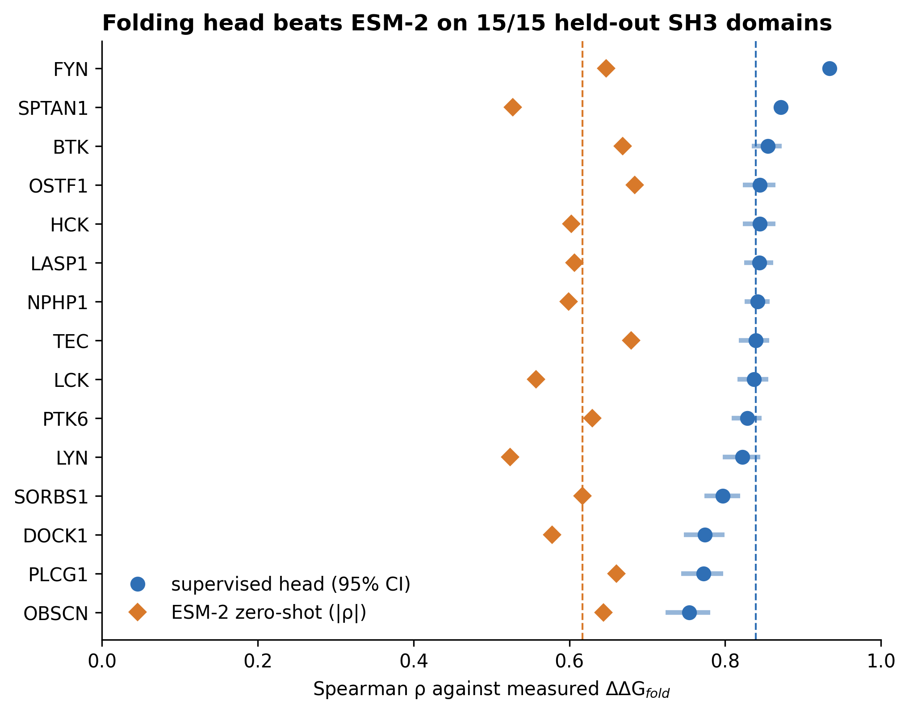

### 5.5 The predictor is specific to folding (B2)

Across the 56 aligned positions, predicted damage correlates with burial at **ρ = +0.712** and with proximity
to the bound peptide at **ρ = +0.037** — a 19-fold difference, obtained without any structural input. Class
medians of predicted ΔΔG follow the measured ordering (buried non-interface 1.40; buried interface 1.21;
surface interface 0.52). On each protein's own AlphaFold model, buried cancer variants are predicted ~3×
more damaging than exposed ones (1.16 vs 0.38 kcal/mol).

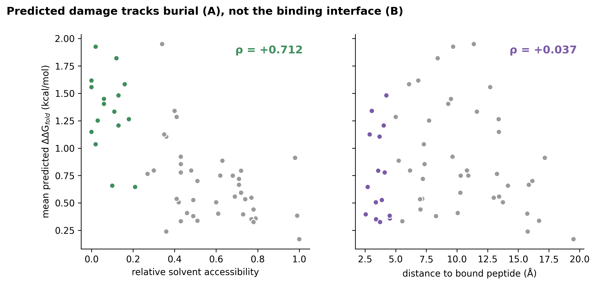

### 5.6 Calibrated calls for the atlas (B3)

Empirical coverage matches nominal from 50 % to 95 % (90 % nominal → 89.9 % empirical; median half-width
1.03 kcal/mol). Coverage is not uniform: 86.9 % for predictions above 2 kcal/mol, and 83.3 % (LYN) to 95.0 %
(FYN) across held-out domains.

| Mechanism label | Variants |
|---|---|
| Tolerated (no call) | 6,283 (91.3 %) |
| **Destabilising** | **297** |
| Both | 113 |
| Rewiring (reported, not claimed) | 191 |

Requiring the whole interval to clear 1 kcal/mol reduces 2,220 point-estimate calls to **410**. The earlier
seed-spread "confidence" filter is discarded: it passed 99.94 % of variants and correlates with the actual
error at only ρ = 0.304.

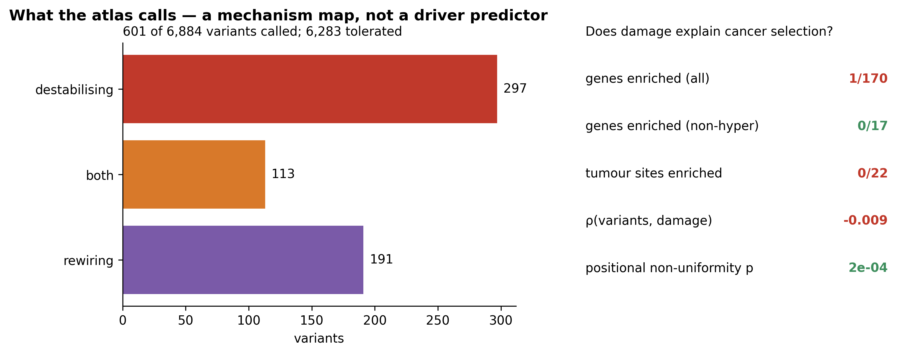

### 5.7 External validation delimits the regime (B4)

On ProteinGym [31], median |ρ|: external stability assays 0.361 (ESM-2 0.406; head wins 2/3); cellular
abundance assays 0.400 (ESM-2 0.491; head wins 6/15); mega-scale-type domains 0.940 (ESM-2 0.580; 10/10). The
head is a **domain-scale specialist**; outside that regime the zero-shot language model is as good or better.
The cancer atlas lies entirely inside the validated regime.

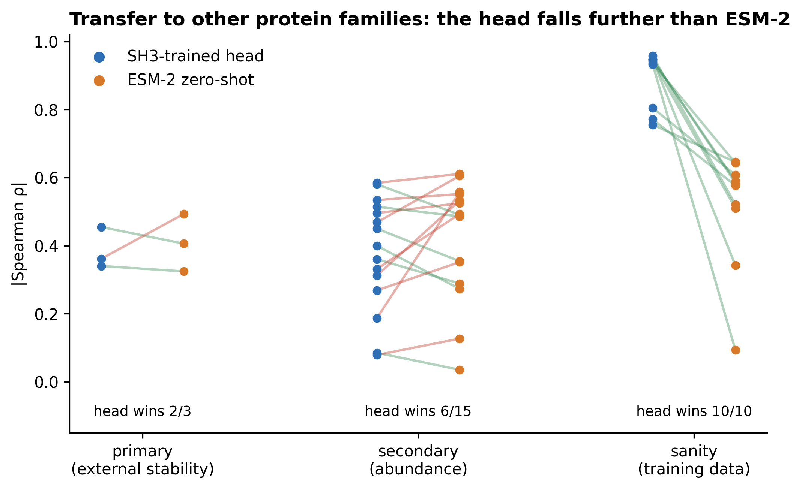

### 5.8 Binding is not predictable for SH3 (C1, C2)

| Design | GRB2-SH3 | PSD95-PDZ3 | GB1 |
|---|---|---|---|
| Leave-one-domain-out, original | +0.097 | +0.112 | −0.090 |
| Leave-one-domain-out, **corrected** | **−0.042** (CI −0.120 to +0.036) | +0.132 | −0.151 |
| Within domain, six repeats, original | −0.030 (range −0.109 to +0.124) | **+0.397** | +0.009 |
| Within domain, six repeats, **corrected** | **−0.020** (range −0.068 to +0.022) | **+0.373** | +0.053 |

Two artefacts of the earlier analysis are removed. First, the small positive cross-domain result came from
using the held-out domain for early stopping. Second, the previously headline within-domain value (+0.124,
bootstrap CI 0.044–0.205) is the best of six repeats; the bootstrap resamples variants within one partition
and cannot see partition-to-partition variance. Consequently the binding axis used downstream is zero-shot
ESM-2 (ρ = −0.126 on GRB2-SH3), recorded in a decision file and labelled weak.

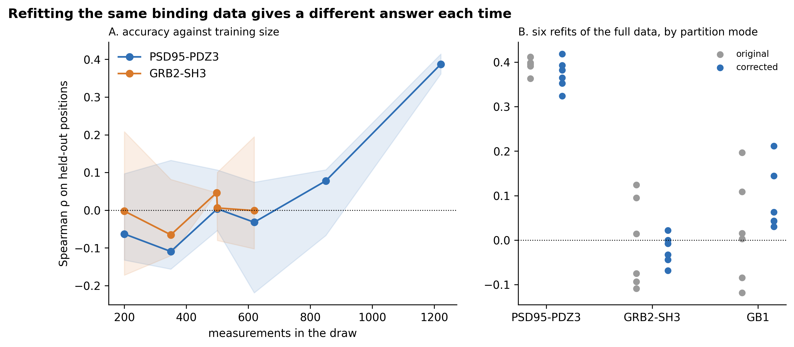

### 5.9 The limiting resource is positional coverage (C3)

| Test on PSD95-PDZ3 | Median ρ |
|---|---|
| Full data | 0.387 (original) / 0.362 (corrected) |
| Reduced to GRB2-SH3's budget (56 positions, 619 measurements), 20 draws | −0.023 / −0.024 |
| **Measurements thinned, all 84 positions kept** | **0.357 / 0.327** |
| **Positions removed at the same measurement budget** | **0.076 / 0.054** |

The position sweep locates the transition: medians are ≈ 0 from 60 to 74 positions, rise at **76**
(Mann–Whitney p = 0.007 against 60) and are robust by **82** (all ten subsets ρ ≥ 0.287). No single position
drives success (enrichment 0.27–0.48 for every position), so the controlling variable is the **count**. An SH3
domain has 56–60 residues, so **no single-domain mutagenesis can reach the threshold**; the remedy is more
domains, not more mutations.

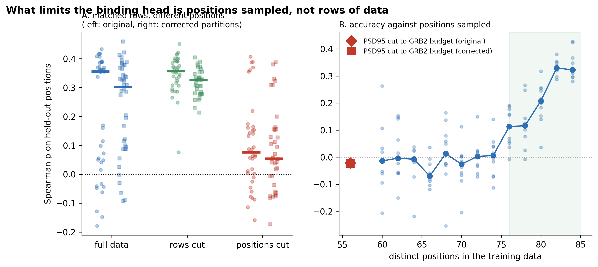

### 5.10 An independent specificity axis fails its pre-registered test (C4)

Across 115 domains in 52 held-out clusters, the model's median centred r is **+0.288** (95 % CI +0.218 to
+0.337) — condition (i) met — but it beats the family-average profile on only **55 of 115** domains, failing
condition (ii). It clearly beats nearest-neighbour transfer (85/115), confirming that homology below 40 %
identity is a poor guide to specificity. Because the axis is not validated, **no rewiring claim is made**, and
the fold-versus-rewiring separation for individual variants remains untested.

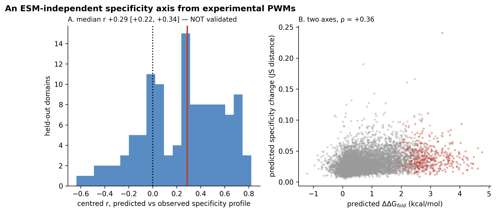

### 5.11 Cancer biology is null (B5)

5.96 % of atlas variants are called destabilising, and 5.59 % of those seen in non-hypermutated tumours.
Against a burial-matched null: **1 of 170 genes** (SPTA1, 18.4 % vs 4.1 % expected, q = 0.085) and **0 of 22
tumour sites** are enriched. Across positions, cancer-variant counts do not track predicted damage
(ρ = −0.009) although predicted damage tracks burial (ρ = +0.712). Positional counts are non-uniform
(p = 2 × 10⁻⁴), but the null assumes uniform mutability and therefore cannot separate selection from
mutational processes [27].

### 5.12 Virtual saturation mutagenesis (B6)

All 366,168 possible substitutions in the 310 atlas domains were predicted (agreement with the pipeline's own
values for observed variants: max difference 9.5 × 10⁻⁷ kcal/mol).

| Set | Destabilising |
|---|---|
| All possible substitutions | 12.1 % |
| Reachable by one nucleotide change | 9.2 % |
| Observed in cancer | 6.0 % |

Against a domain-matched, single-nucleotide background, observed variants are **depleted** of fold-breaking
substitutions (5.93 % vs 9.18 %; one-sided p ≤ 0.001, 1,000 draws). This is consistent with weak purifying
selection against loss of SH3 folds in tumours, but codon usage and trinucleotide context are not modelled, so
mutational bias cannot be excluded. Family-wide, predicted damage tracks burial at ρ = +0.775, and the most
fragile aligned positions (19, 25, 47, 5, 27) are buried core positions where ~half of all substitutions are
confidently destabilising.

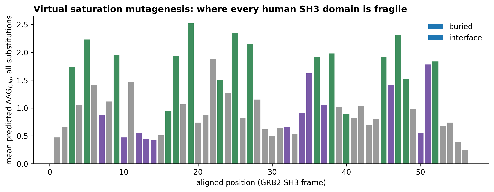

### 5.13 A candidate panel for experimental validation (F1, F2)

Ten destabilising picks (lower bounds 2.47–3.81 kcal/mol, all above the 99.65th percentile of the atlas) are
paired with ten predicted-neutral controls from the same domains, giving a positive and a negative per protein
background. No rewiring panel is built, because C4 did not validate. The panel is currently concentrated: it
covers 6 of 56 aligned positions, with four picks at aligned position 5, and four substitutions to proline —
the class where the model is least accurate.

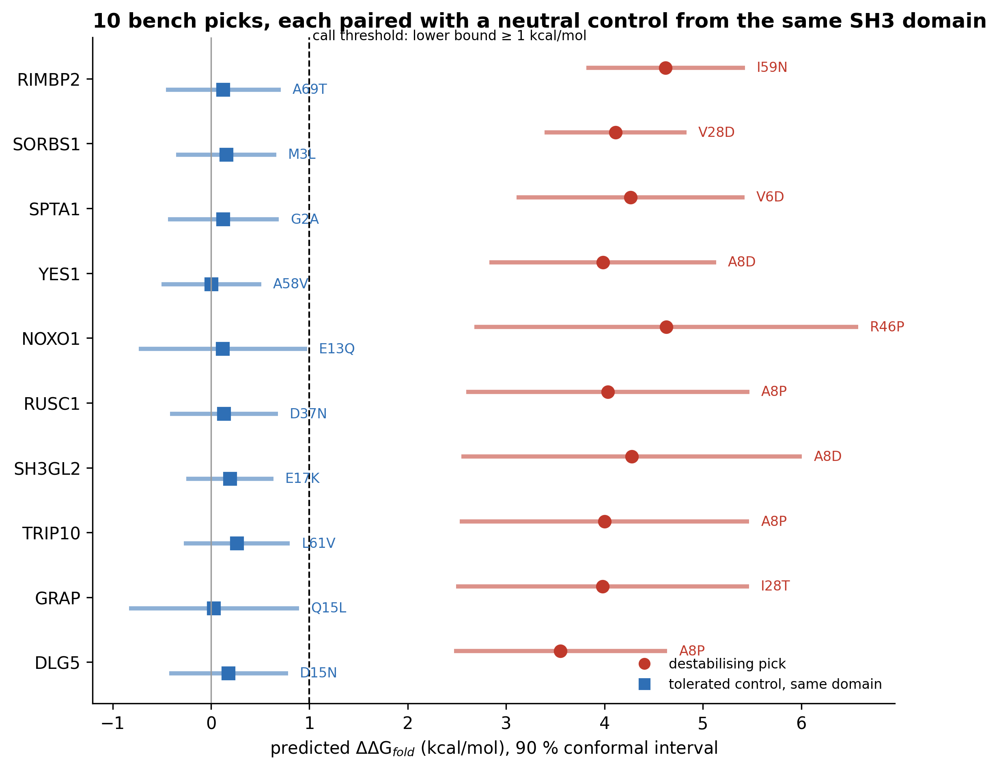

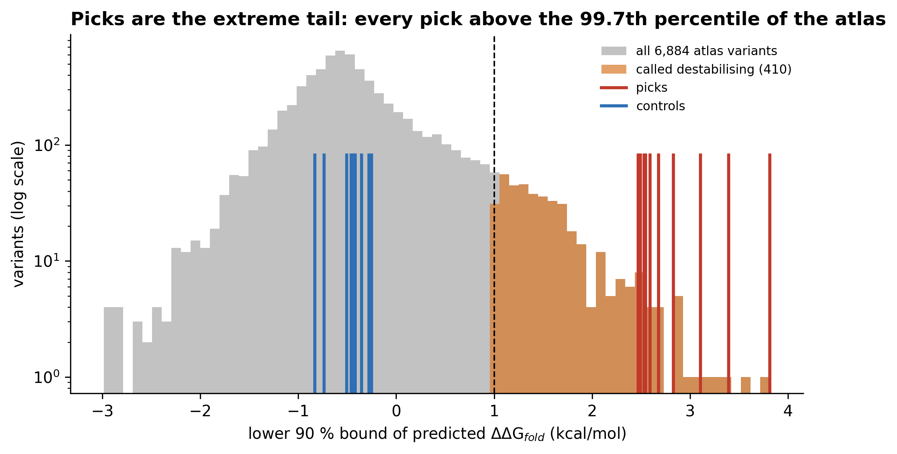

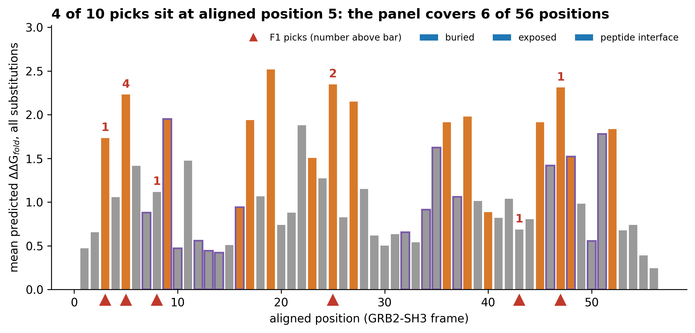

---

## 6. Discussion

**A mechanism map, not a driver list.** The atlas supports confident statements about *what a variant does to
the fold* for 410 variants, and no statement about *whether it drives cancer*: enrichment tests are null, and
recurrence-based annotation flags nothing in this family. This distinction should be preserved whenever these
predictions are used.

**Why folding transfers and binding does not.** Folding stability depends on local packing and on the
physico-chemical character of the substituted residue, features that recur across unrelated small domains, so
a model trained on hundreds of non-SH3 domains transfers. Binding depends on the identity of the partner:
GB1 binds an immunoglobulin Fc region, GRB2-SH3 a proline-rich peptide, PSD95-PDZ3 a C-terminal motif. There
is no shared coordinate system to transfer, which is why the cross-domain design (C1) cannot work in
principle, and why the honest test is within a domain.

**The threshold is about positions, and it has a natural interpretation.** Predicting binding at an *unseen
position* requires learning how the contribution to binding depends on positional context. Many substitutions
at few positions teach substitution preferences, not positional dependence. The sweep places the requirement
at the order of 80 distinct positions for a domain like PDZ3 — beyond the size of an SH3 domain. The practical
consequence is a concrete experimental recommendation: ddPCA-style binding measurements for 15–20 SH3 domains
against a shared ligand, aligned on one frame, would supply in aggregate what one domain cannot.

**Negative results reported as such.** Three findings are negative and are stated without hedging: binding is
unpredictable for SH3 from current data; the independent specificity axis fails its own pre-registered rule;
and the cancer biology shows no enrichment. Reporting them is what makes the positive folding result
interpretable, because the same pipeline, features and evaluation produced both.

**Relation to the earlier run.** All headline numbers reproduce. What changed is their validity: a FoldX
residue-numbering error (pooled r 0.494 → 0.418), an absolute-value win criterion that counted
wrong-direction correlations, a leakage path in the cross-domain design, and the replacement of single fits by
repeat distributions. In three places the corrected number is less favourable than the previous one; in each
case the corrected number is reported.

---

## 7. Limitations

1. **One SH3 domain with binding energies.** Every SH3 binding statement rests on GRB2-SH3 with a single ligand.
2. **Threshold calibrated on one domain.** The ~80-position requirement comes from PSD95-PDZ3; "of the order of 80" is the defensible phrasing.
3. **Conformal exchangeability.** Intervals are calibrated on held-out mega-scale SH3 domains and applied to human cancer variants; the assumption is reasonable but untested, and per-domain coverage ranges 83–95 %.
4. **Compression of severe effects.** Predictions under-estimate large destabilisations, so effect sizes are conservative and stabilising variants are not detectable.
5. **Both atlas axes derive from ESM-2**, so their mutual correlation (ρ = 0.675) is not evidence about mechanism separation.
6. **Simplified mutational null.** B5 and B6 model burial and single-nucleotide reachability but not trinucleotide context or codon usage; the observed depletion therefore cannot yet be attributed to selection.
7. **Structural coverage.** 219 variants in nine very large proteins lack AlphaFold coverage because only the first model fragment is retrieved.
8. **Power.** Only 17 genes have ≥ 20 variants in non-hypermutated tumours.

---

## 8. Conclusions

For human SH3 domains, a supervised head on frozen protein-language-model features predicts folding
destabilisation for domains it has never seen (median ρ 0.839; 15/15 against zero-shot ESM-2), does so
specifically (burial ρ +0.712 vs interface +0.037), and yields calibrated intervals from which 410 of 6,884
COSMIC variants are confidently called destabilising. Rewiring of binding cannot be predicted for this family
from the data that exist, and the obstacle is measured rather than asserted: the number of distinct mutated
positions, ~80 required against 56–60 available. An independent route through specificity profiles was tried
under a pre-registered rule and failed. The complete pipeline reproduces from raw data, 187 of 187 recorded
values, and the analysis of what an SH3 cancer variant does can therefore be repeated, audited and extended.

---

## 9. Data and code availability

- **Code, documentation and small result files:** private repository `hafijbd/sh3-mechanism` (16 Colab notebooks, shared module, per-program explanations and reports).
- **Raw and derived data** (COSMIC archives, the atlas, per-variant prediction tables, embeddings and model weights) remain on Google Drive and are **not redistributed**: COSMIC's licence forbids it.
- **Public source data:** ddPCA/MoCHI [2], mega-scale stability [3], ProteinGym [31], SH3 specificity profiles [9], AlphaFold models [13], UniProt [8], COSMIC (licensed) [7].

---

## 10. References

1. Mayer BJ. SH3 domains: complexity in moderation. *Journal of Cell Science* 2001;114(7):1253–1263.
2. Faure AJ, Domingo J, Schmiedel JM, Hidalgo-Carcedo C, Diss G, Lehner B. Mapping the energetic and allosteric landscapes of protein binding domains. *Nature* 2022;604(7904):175–183. doi:10.1038/s41586-022-04586-4
3. Tsuboyama K, Dauparas J, Chen J, et al. Mega-scale experimental analysis of protein folding stability in biology and design. *Nature* 2023;620(7973):434–444. doi:10.1038/s41586-023-06328-6
4. Lin Z, Akin H, Rao R, et al. Evolutionary-scale prediction of atomic-level protein structure with a language model. *Science* 2023;379(6637):1123–1130. doi:10.1126/science.ade2574
5. Rives A, Meier J, Sercu T, et al. Biological structure and function emerge from scaling unsupervised learning to 250 million protein sequences. *PNAS* 2021;118(15):e2016239118. doi:10.1073/pnas.2016239118
6. Meier J, Rao R, Verkuil R, Liu J, Sercu T, Rives A. Language models enable zero-shot prediction of the effects of mutations on protein function. *Advances in Neural Information Processing Systems* 2021;34.
7. Sondka Z, Dhir NB, Carvalho-Silva D, et al. COSMIC: a curated database of somatic variants and clinical data for cancer. *Nucleic Acids Research* 2024;52(D1):D1210–D1217. doi:10.1093/nar/gkad986
8. The UniProt Consortium. UniProt: the Universal Protein Knowledgebase in 2023. *Nucleic Acids Research* 2023;51(D1):D523–D531. doi:10.1093/nar/gkac1052
9. Teyra J, Huang H, Jain S, et al. Comprehensive analysis of the human SH3 domain family reveals a wide variety of non-canonical specificities. *Structure* 2017;25(10):1598–1610.e3. doi:10.1016/j.str.2017.07.017
10. Schymkowitz J, Borg J, Stricher F, Nys R, Rousseau F, Serrano L. The FoldX web server: an online force field. *Nucleic Acids Research* 2005;33(Web Server issue):W382–W388. doi:10.1093/nar/gki387
11. Frazer J, Notin P, Dias M, et al. Disease variant prediction with deep generative models of evolutionary data. *Nature* 2021;599(7883):91–95. doi:10.1038/s41586-021-04043-8
12. Jumper J, Evans R, Pritzel A, et al. Highly accurate protein structure prediction with AlphaFold. *Nature* 2021;596(7873):583–589. doi:10.1038/s41586-021-03819-2
13. Varadi M, Anyango S, Deshpande M, et al. AlphaFold Protein Structure Database: massively expanding the structural coverage of protein-sequence space with high-accuracy models. *Nucleic Acids Research* 2022;50(D1):D439–D444. doi:10.1093/nar/gkab1061
14. Kyte J, Doolittle RF. A simple method for displaying the hydropathic character of a protein. *Journal of Molecular Biology* 1982;157(1):105–132. doi:10.1016/0022-2836(82)90515-0
15. Henikoff S, Henikoff JG. Amino acid substitution matrices from protein blocks. *PNAS* 1992;89(22):10915–10919. doi:10.1073/pnas.89.22.10915
16. Vovk V, Gammerman A, Shafer G. *Algorithmic Learning in a Random World.* Springer; 2005.
17. Papadopoulos H, Proedrou K, Vovk V, Gammerman A. Inductive confidence machines for regression. *Machine Learning: ECML 2002*, Lecture Notes in Computer Science 2430:345–356. doi:10.1007/3-540-36755-1_29
18. Lei J, G'Sell M, Rinaldo A, Tibshirani RJ, Wasserman L. Distribution-free predictive inference for regression. *Journal of the American Statistical Association* 2018;113(523):1094–1111. doi:10.1080/01621459.2017.1307116
19. Benjamini Y, Hochberg Y. Controlling the false discovery rate: a practical and powerful approach to multiple testing. *Journal of the Royal Statistical Society, Series B* 1995;57(1):289–300.
20. Harris CR, Millman KJ, van der Walt SJ, et al. Array programming with NumPy. *Nature* 2020;585(7825):357–362. doi:10.1038/s41586-020-2649-2
21. Virtanen P, Gommers R, Oliphant TE, et al. SciPy 1.0: fundamental algorithms for scientific computing in Python. *Nature Methods* 2020;17(3):261–272. doi:10.1038/s41592-019-0686-2
22. Pedregosa F, Varoquaux G, Gramfort A, et al. Scikit-learn: machine learning in Python. *Journal of Machine Learning Research* 2011;12:2825–2830.
23. Paszke A, Gross S, Massa F, et al. PyTorch: an imperative style, high-performance deep learning library. *Advances in Neural Information Processing Systems* 2019;32.
24. Cock PJA, Antao T, Chang JT, et al. Biopython: freely available Python tools for computational molecular biology and bioinformatics. *Bioinformatics* 2009;25(11):1422–1423. doi:10.1093/bioinformatics/btp163
25. Hunter JD. Matplotlib: a 2D graphics environment. *Computing in Science & Engineering* 2007;9(3):90–95. doi:10.1109/MCSE.2007.55
26. Shrake A, Rupley JA. Environment and exposure to solvent of protein atoms. Lysozyme and insulin. *Journal of Molecular Biology* 1973;79(2):351–371. doi:10.1016/0022-2836(73)90011-9
27. Alexandrov LB, Kim J, Haradhvala NJ, et al. The repertoire of mutational signatures in human cancer. *Nature* 2020;578(7793):94–101. doi:10.1038/s41586-020-1943-3
28. Martincorena I, Raine KM, Gerstung M, et al. Universal patterns of selection in cancer and somatic tissues. *Cell* 2017;171(5):1029–1041.e21. doi:10.1016/j.cell.2017.09.042
29. Troilo F, Bonetti D, Camilloni C, Toto A, Longhi S, Brunori M, Gianni S. Folding mechanism of the SH3 domain from Grb2. *The Journal of Physical Chemistry B* 2018;122(49):11166–11173. doi:10.1021/acs.jpcb.8b06320
30. Chi CN, Elfström L, Shi Y, Snäll T, Engström Å, Jemth P. Reassessing a sparse energetic network within a single protein domain. *PNAS* 2008;105(12):4679–4684. doi:10.1073/pnas.0711732105
31. Notin P, Kollasch A, Ritter D, et al. ProteinGym: large-scale benchmarks for protein fitness prediction and design. *Advances in Neural Information Processing Systems* 2023;36:64331–64379.

**Background literature cited in Section 2**

32. Saksela K, Permi P. SH3 domain ligand binding: what's the consensus and where's the specificity? *FEBS Letters* 2012;586(17):2609–2614. doi:10.1016/j.febslet.2012.04.042
33. Fowler DM, Fields S. Deep mutational scanning: a new style of protein science. *Nature Methods* 2014;11(8):801–807. doi:10.1038/nmeth.3027
34. Stein A, Fowler DM, Hartmann-Petersen R, Lindorff-Larsen K. Biophysical and mechanistic models for disease-causing protein variants. *Trends in Biochemical Sciences* 2019;44(7):575–588. doi:10.1016/j.tibs.2019.01.003
35. Sahni N, Yi S, Taipale M, et al. Widespread macromolecular interaction perturbations in human genetic disorders. *Cell* 2015;161(3):647–660. doi:10.1016/j.cell.2015.04.013
36. Richards S, Aziz N, Bale S, et al. Standards and guidelines for the interpretation of sequence variants: a joint consensus recommendation of the American College of Medical Genetics and Genomics and the Association for Molecular Pathology. *Genetics in Medicine* 2015;17(5):405–424. doi:10.1038/gim.2015.30
37. Bailey MH, Tokheim C, Porta-Pardo E, et al. Comprehensive characterization of cancer driver genes and mutations. *Cell* 2018;173(2):371–385.e18. doi:10.1016/j.cell.2018.02.060
38. Brandes N, Goldman G, Wang CH, Ye CJ, Ntranos V. Genome-wide prediction of disease variant effects with a deep protein language model. *Nature Genetics* 2023;55(9):1512–1522. doi:10.1038/s41588-023-01465-0
39. Cheng J, Novati G, Pan J, et al. Accurate proteome-wide missense variant effect prediction with AlphaMissense. *Science* 2023;381(6664):eadg7492. doi:10.1126/science.adg7492
40. Pucci F, Bernaerts KV, Kwasigroch JM, Rooman M. Quantification of biases in predictions of protein stability changes upon mutations. *Bioinformatics* 2018;34(21):3659–3665. doi:10.1093/bioinformatics/bty348

**A note on the references.** Numbering follows the two groups above: 1–31 are the datasets, tools and
methods of the pipeline, 32–40 the background literature of Section 2. Entries 2, 3, 7, 9, 29, 30, 31 and
32–40 were verified against the publishers' records while this report was written (journal, year, volume and
pages; for 29 also the full author list). The
remaining entries are the standard citations for the datasets, tools and methods used; check their page
numbers in your reference manager before submission, and expand the "et al." author lists to the style your
department requires.
