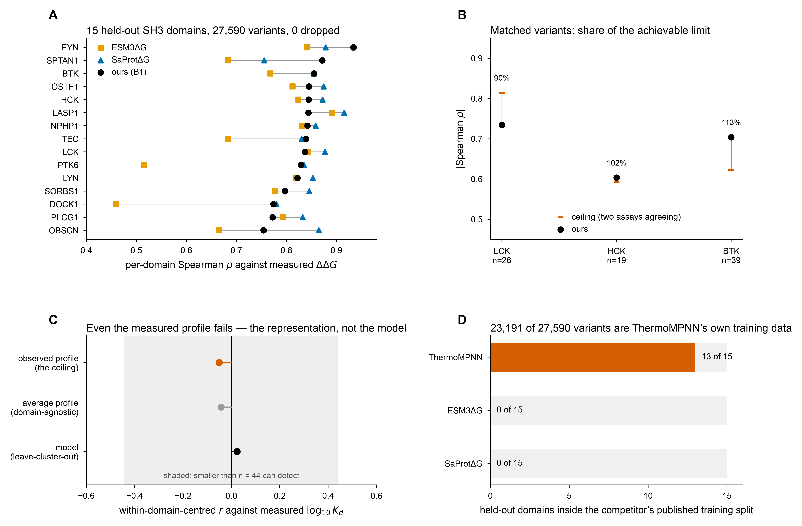

# What the extended phase changed

A single comparison of the frozen 2026-09-22 run against everything done on 26–27 September 2026.

**The frozen run is untouched.** Nothing below re-ran, re-fitted or re-published a frozen number. Every
program here is evaluation-only: new data, new labels, new baselines, read against results that already
existed. `input/frozen/` is `chmod a-w` to make that physical.

*Figure 1 — what the extended phase established.* **A** per-domain ρ on the 15 held-out domains
against two structure-conditioned predictors. **B** our correlation as a share of the agreement
between two independent assays. **C** the specificity axis with its domain-agnostic baseline and the
observed-profile control; the shaded band is everything 44 measurements cannot resolve. **D** the
leakage audit. Generated by `tools/fig_outcomes.py` from the committed result tables.

---

## The four objections, before and after

| # | Objection | 22 Sep | 27 Sep |
|---|---|---|---|
| 1 | You only beat zero-shot ESM-2, FoldX and EVE | open | **closed** — level with SaProtΔG, better than ESM3ΔG (p = 0.0084) |
| 2 | The B6 depletion could be mutational bias, not selection | open | **still open** — E1's germline arm is underpowered by ~10× |
| 3 | Generality asserted from *n* = 1, twice | open | **partly closed** — E2 spans 41 domains, 32 genes |
| 4 | Nothing was measured | open | **closed for the ranking** — E2 (abundance) and E1 (clinical labels), both external |

Three of four moved. **Objection 2 did not**, and that is the honest headline of this phase.

---

## Program by program

### X0 · acquire the external data
74,116 ClinVar records, 431,959 gnomAD missense variants, 46,128 Domainome SH3 measurements, joined
onto the frozen predictions **without changing the atlas row count (6,884)**.

Three join defects were caught by that assertion: 45 null-key rows, 3,856 dual-Pfam duplicates, 249
contradictory ClinVar keys. A gnomAD caching bug that recorded failures as "no variants" would have
silently lost ARHGEF4's 8,140 variants.

### E1 · ClinVar and gnomAD — *the ranking tracks pathogenicity; the binary call does not*

| | pathogenic | benign |
|---|---|---|
| n (1+ star, in domain, scored) | 21 | 101 |
| median predicted ΔΔG | **1.67** | **0.19** kcal/mol |

p = 4.9 × 10⁻⁶, rank-biserial **+0.615**. The head never saw a clinical label.

But `fold_lo ≥ 1` flags **4.8 %** of pathogenic variants against Beltran's ~60 %. That is not a
disagreement about biology — it is what a 90 % conformal lower bound means. **Report ΔΔG with its
interval; do not present `fold_lo ≥ 1` as a clinical filter without its sensitivity beside it.**

Q2, the germline depletion: 0 of 35 common variants destabilising against 9.63 % expected,
**p = 0.0289 against a pre-registered α = 0.025**. Missed by 0.004. The rule was written first, so the
verdict is *consistent with depletion, not established*.

### E2 · Domainome — *measured, and near the achievable limit*

880 atlas variants have a direct abundance measurement across **41 domains and 32 genes**. Pooled
|ρ| = **0.600**; 21 of 21 sufficiently sampled domains correlate in the right direction.

The number that makes it meaningful: **two independent assays agree with each other at |ρ| = 0.709.**
So 0.600 is near the ceiling, not a moderate result — and on matched variants the head reaches
**90–113 %** of it.

### E3 · benchmark against current predictors — *level with one, better than the other*

| competitor | median ρ | ours | diff | p | verdict |
|---|---|---|---|---|---|
| SaProtΔG | +0.855 | +0.839 | −0.028 | 0.107 | no clear difference |
| ESM3ΔG | +0.792 | +0.839 | +0.033 | **0.0084** | **ours better** |

27,590 variants scored by each, **0 dropped**. **Our head is sequence-only and saw no SH3 domain in
training; both competitors receive the measured construct's experimental structure.**

Consistency is the finding: ESM3ΔG ranges 0.460–0.892 across domains, we range 0.754–0.934. Our worst
domain beats its fifth-worst.

**The leakage audit is the more durable half**: SaProtΔG 0 of 15, ESM3ΔG 0 of 15, **ThermoMPNN 13 of
15** — 23,191 of 27,590 held-out variants inside its own train or validation split. A MegaScale-derived
benchmark cannot compare MegaScale-trained predictors without that check.

### E4 · independent test of the specificity axis — *the representation, not the model*

C4 had already failed its own rule (`validated: false`, median centred r = +0.288). E4 tested it
against 44 affinities measured by another group: model r = **+0.023** (p = 0.91), and it does not beat
a domain-agnostic baseline.

**The control decides the reading.** The *observed* phage-display profile — the quantity the model is
trained to predict — fails identically (r = −0.051, p = 0.80). A predictor of X cannot beat X, so no
improvement to C4's regression could have produced a positive result. Collapsing a 14-position PWM to
composition discards order, and SH3 ligand classes differ by order at identical composition.

The verdict is *the measurement, not the model* — narrower and better founded than "the axis fails".

### X1 · dbNSFP — *acquired, not yet usable as a comparison*

2,120,008 rows reduced to **152,852 inside an SH3 domain**. Predictor coverage now matches dbNSFP's
published figures to within a few points, after four defects — the worst of which mislabelled every
predictor column while leaving the file complete and plausible.

**63.8 % of our in-domain ClinVar variants appear in dbNSFP's set, and that is unexplained.** Two
hypotheses were tested and refuted. Until it is resolved, dbNSFP's ClinVar column is not a valid
cross-check on ours.

---

## Every comparable number, side by side

| quantity | 2026-09-22 (frozen) | 26–27 Sep (extended) | source |
|---|---|---|---|
| Atlas variants | 6,884 in 310 domains | **6,884**, join asserted unchanged | X0 |
| Per-domain folding ρ, 15 held-out | **0.839** median | **0.839**, re-derived from frozen predictions | E3 |
| Best competitor on the same 15 | ESM-2 zero-shot, beaten 15/15 | SaProtΔG **0.855**, ESM3ΔG **0.792** | E3 |
| Variants in the benchmark | 27,590 held-out | 27,590 scored by each, **0 dropped** | E3 |
| Conformal q90 / coverage | 6.807 / 89.9 % | unchanged, not re-fitted | — |
| Confident destabilising calls | 410 of 6,884 (6.0 %) | unchanged; **sensitivity now measured at 4.8 %** on pathogenic | E1 |
| External measured validation | none | 880 variants, 41 domains, pooled \|ρ\| **0.600** | E2 |
| Noise ceiling | unknown | **0.709** between two independent assays | E2 |
| Fraction of ceiling reached | unknown | **90–113 %** on matched variants | E2 |
| Clinical separation | none | median ΔΔG **1.67 vs 0.19**, p = 4.9 × 10⁻⁶ | E1 |
| Rank-biserial, pathogenic vs benign | none | **+0.615** (AUC ≈ 0.81) | E1 |
| Cancer depletion | 5.93 % vs 9.18 %, p = 0.001 | **not independently tested** | E1 Q2 |
| Germline depletion | none | 0 of 35 vs 9.63 %, p = 0.0289 vs α = 0.025 | E1 Q2 |
| Specificity axis | median centred r **+0.288**, `validated: false` | re-run reproduces **+0.288** to 1.6 × 10⁻¹⁴; external r = **+0.023** | E4 |
| Specificity, observed-profile control | none | r = **−0.051**, p = 0.80 — the ceiling also fails | E4 |
| Predictor leakage audited | none | SaProtΔG 0/15, ESM3ΔG 0/15, **ThermoMPNN 13/15** | E3 |
| dbNSFP predictors in domain | none | 152,852 rows, ~50 scores, coverage matches publisher | X1 |
| Recorded values reproduced | 187/187 | untouched — nothing re-run | — |

Two rows carry the whole story. **`0.839` appears identically in both columns** — the extended phase
re-derived it from the frozen predictions and asserted the match, so every comparison here is against
the published model and not a re-fit of it. And **`5.93 % vs 9.18 %` is the one frozen number with no
independent support**, which is what G1 is for.

## What the frozen run said, and whether it survived

| frozen claim | 22 Sep value | extended verdict |
|---|---|---|
| Per-domain folding accuracy | median ρ **0.839**, 15 held-out domains | **holds** — re-derived exactly in E3, and competitive with two current predictors |
| Beats zero-shot ESM-2 | 15/15 domains | **holds**, and now against supervised predictors too |
| Conformal calls | q90 = 6.807, coverage 89.9 %, 410 confident | **holds, with a stated cost** — E1 shows sensitivity is 4.8 % on pathogenic variants |
| Cancer variants depleted of damage | 5.93 % observed vs 9.18 % expected, p = 0.001 | **untested** — E1's germline arm could not reach significance; G1 is the only route |
| Specificity axis | median centred r +0.288, `validated: false` | **confirmed failed, independently** — and now attributed to the representation |
| Reproduction | 187/187 recorded values | **untouched** — nothing was re-run |

**Nothing the frozen run claimed was overturned.** One claim (the depletion) remains unsupported by
independent evidence, which is what G1 exists for.

---

## What is genuinely new

1. **External measured validation.** E2's 880 variants and the 0.709 noise ceiling did not exist on
   22 September. The model is now measured against a different assay, in a different laboratory.
2. **Clinical labels.** E1's 21 vs 101 separation at p = 4.9 × 10⁻⁶.
3. **A real benchmark.** E3 against two current supervised predictors, both structure-conditioned,
   with a leakage audit that disqualified a third.
4. **A second, independent negative on the specificity axis**, correctly attributed.
5. **Pre-registration as standing practice.** E1, E3 and E4 each had their rule committed to git before
   the notebook existed. It paid twice: E3's pre-commit check disqualified ThermoMPNN, and E4's control
   table stopped a wrong conclusion being drawn from a correct number.

## What is still missing

| | why it matters |
|---|---|
| **G1** | the only route to objection 2, the one frozen claim without independent support |
| **G4** | the F1 panel has 4 of 10 picks at one aligned position and 4 prolines — fix before anything is synthesised |
| X1's 63.8 % | blocks any dbNSFP-based follow-up to E1 |
| E3 Experiments 2–4, ThermoMPNN | sensitivity checks; cannot change Experiment 1's verdict |
| H1, H2 | generality beyond SH3, and bench validation |

**Phase 1 plus rewriting the report as a paper is a credible submission.** G1 is the gap a reviewer
would find first.
